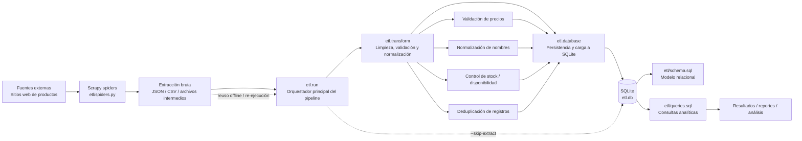

# Pipeline Flow del ETL de Productos Web

Este documento complementa la documentación original del repositorio sin modificar ni reemplazar la estructura, archivos ni contenido existentes. Su propósito es dejar un panorama profesional del flujo de datos del proyecto, con una visión técnica, operativa y de trazabilidad del proceso ETL.

## 1. Visión general

El repositorio implementa un pipeline ETL orientado a la extracción de información comercial desde sitios web, transformación de datos para normalización y calidad, y carga final en una base de datos relacional SQLite.

El flujo general sigue el patrón clásico de ingeniería de datos:

Extract → Transform → Load → Query / Reporting

Este enfoque permite:

- obtener datos en bruto desde fuentes externas
- limpiar y estructurar la información
- dejarla lista para análisis
- responder consultas de negocio y generar reportes

## 2. Diagrama de flujo de datos (Pipeline Flow)



## 3. Descripción del pipeline

### 3.1. Capa de extracción

La primera etapa consiste en obtener los datos desde las fuentes externas con Scrapy.

Componentes clave:

- `etl/spiders.py`: define los spiders encargados de navegar, consultar y extraer contenido web.
- `etl_output/`: contiene los resultados intermedios de la extracción.
- `etl.run`: funciona como orquestador del pipeline y coordina la ejecución de cada fase.

Objetivo:

- traer la información cruda sin perder contexto
- conservar un estado intermedio reutilizable
- facilitar la ejecución local o con datos ya descargados

### 3.2. Capa de transformación

La segunda etapa limpia y normaliza la data para convertirla en información útil para análisis.

En esta fase se aplican tareas como:

- limpieza de precios
- estandarización de nombres y descripciones
- validación de disponibilidad y stock
- tratamiento de valores nulos o inconsistentes
- deduplicación de registros
- preparación de campos para el esquema relacional

Archivo principal:

- `etl/transform.py`

La transformación es clave, porque la calidad del dato final depende de la consistencia de esta etapa.

### 3.3. Capa de carga

La información ya transformada se incorpora a SQLite usando la lógica de carga del proyecto.

Componentes:

- `etl/database.py`: lógica para crear, actualizar y poblar la base de datos
- `etl/schema.sql`: definiciones del modelo relacional
- `etl.db`: base de datos final donde queda persistida la información

El esquema relacional contempla tablas como:

- `fuentes`: origen de los datos
- `productos`: entidad base para productos comunes
- `libros`: información específica del catálogo de libros
- `tecnologia`: información específica de laptops y hardware
- `categorias`: clasificación normalizada de productos

### 3.4. Capa analítica

Una vez cargados los datos, se ejecutan consultas analíticas para responder preguntas del laboratorio y obtener resultados estructurados.

Archivo principal:

- `etl/queries.sql`

Esta capa permite:

- validar calidad de datos
- responder preguntas de negocio
- generar análisis de productos, categorías, disponibilidad y relaciones entre entidades

## 4. Flujo de datos en formato lineal

```text
[Fuentes web]
      ↓
[Scrapy spiders]
      ↓
[Datos extraídos brutos]
      ↓
[etl.run (orquestador)]
      ↓
[etl.transform (limpieza + normalización)]
      ↓
[etl.database + schema.sql]
      ↓
[SQLite: etl.db]
      ↓
[etl.queries.sql]
      ↓
[Resultados analíticos / reportes]
```

## 5. Mapeo funcional de archivos

| Etapa | Archivo | Rol dentro del pipeline |
| --- | --- | --- |
| Extracción | `etl/spiders.py` | Consulta fuentes web y obtiene registros |
| Orquestación | `etl/run.py` | Ejecuta la secuencia completa del ETL |
| Transformación | `etl/transform.py` | Limpia, valida y normaliza los datos |
| Persistencia | `etl/database.py` | Inserta y actualiza datos en SQLite |
| Modelo | `etl/schema.sql` | Define tablas y estructura del almacenamiento |
| Consultas | `etl/queries.sql` | Ejecuta análisis sobre la base de datos |
| Base de datos | `etl.db` | Almacén final relacional |
| Salida intermedia | `etl_output/` | Guarda datos extraídos para reutilización |

## 6. Principios del diseño del pipeline

El flujo actual refleja buenas prácticas básicas de ingeniería de datos:

- separación clara entre extracción, transformación y carga
- trazabilidad del dato desde la fuente hasta la base final
- reutilización de archivos intermedios
- capacidad de reejecución sin depender siempre de la red
- esquema relacional para análisis estructurado
- ejecución controlada desde un punto central: `etl.run`

## 7. Calidad y gobernanza de datos

Aunque el proyecto es de carácter académico y operativo, el diseño incorpora varios criterios de calidad:

- validación de atributos clave
- limpieza de campos inconsistentes
- eliminación de duplicados
- estandarización de nombres, categorías y valores
- preparación de la información para consultas SQL y análisis posterior

Esto convierte el pipeline en una base sólida para trabajo más avanzado con reporting, BI o modelado analítico.

## 8. Resumen ejecutivo

El proceso del repositorio puede describirse como un ETL profesional ligero con estas características:

1. extracción desde fuentes web usando Scrapy
2. almacenamiento de datos intermedios en archivos de salida
3. transformación y limpieza para mejorar consistencia
4. carga a SQLite con esquema relacional
5. consulta analítica mediante SQL y generación de resultados

En términos operativos, este flujo es reproducible, comprensible y extensible, y representa una estructura adecuada para proyectos de extracción y análisis de datos en entornos académicos o de laboratorio.

## 9. Nota final

Este documento es adicional y complementario a la documentación principal del repositorio. No reemplaza ni modifica ninguno de los archivos originales, sino que aporta una vista profesional del pipeline para facilitar su entendimiento, mantenimiento y presentación técnica.
