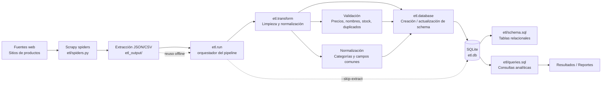

# Pipeline Flow - Laboratorio ETL con Scrapy y SQLite

Este documento es adicional al repositorio y no modifica ni reemplaza la documentación existente. Su objetivo es dejar de forma clara y profesional el flujo de datos del proceso ETL actual.

## Visión general

El proyecto combina extracción web con Scrapy, transformación de datos y carga en SQLite. El flujo principal sigue el patrón clásico de ETL:

Extract -> Transform -> Load -> Query / Reporting

## Diagrama de flujo de datos (Pipeline Flow)



## Descripción detallada del flujo

### 1) Fuente de datos

El sistema toma información desde sitios web relevantes para productos como:
- libros
- laptops / tecnología

Estos datos son extraídos con Scrapy mediante spiders configurados en `etl/spiders.py`.

### 2) Extracción

La etapa de extracción se coordina desde `etl/run.py`.

Responsabilidades:
- invocar al spider o reutilizar archivos ya descargados
- guardar resultados intermedios en `etl_output/`
- preparar el conjunto bruto para la limpieza

Flujo:
- Scrapy spider -> JSON/CSV -> carpeta de salida

### 3) Transformación

La lógica de limpieza y preparación se encuentra en `etl/transform.py`.

Incluye tareas como:
- limpieza de precios
- normalización de calificaciones
- validación de disponibilidad
- estandarización de nombres y categorías
- deduplicado de registros
- preparación de campos para el modelo relacional

Resultado:
- datos estandarizados y consistentes
- estructura lista para cargar en SQLite

### 4) Carga (Load)

La capa de persistencia está en `etl/database.py` junto con el esquema en `etl/schema.sql`.

Responsabilidades:
- crear o actualizar la base de datos `etl.db`
- crear tablas relacionales
- insertar registros normalizados
- mantener relaciones entre entidades:
  - `fuentes`
  - `productos`
  - `libros`
  - `tecnologia`
  - `categorias`

### 5) Consultas y analítica

Una vez cargados los datos, las consultas del laboratorio se ejecutan desde `etl/queries.sql`.

El patrón de uso es:
- consultar SQLite
- responder preguntas de negocio / laboratorio
- generar resultados de análisis

## Flujo de datos en formato texto

```text
[Fuentes web]
      ↓
[Scrapy spiders]
      ↓
[Extracción JSON/CSV]
      ↓
[etl.run (orquestador)]
      ↓
[etl.transform (limpieza + normalización)]
      ↓
[etl.database + etl.schema.sql]
      ↓
[SQLite: etl.db]
      ↓
[etl.queries.sql]
      ↓
[Resultados / Reportes]
```

## Mapeo funcional con archivos del proyecto

| Etapa | Archivo principal | Función |
| --- | --- | --- |
| Extracción | `etl/spiders.py` | Obtiene datos desde sitios web |
| Orquestación | `etl/run.py` | Ejecuta pipeline completo |
| Transformación | `etl/transform.py` | Limpia y normaliza registros |
| Carga | `etl/database.py` | Guarda datos en SQLite |
| Modelo | `etl/schema.sql` | Define tablas y estructura relacional |
| Consultas | `etl/queries.sql` | Ejecuta análisis solicitados |
| Base de datos | `etl.db` | Almacena la información final |

## Resumen ejecutivo

El pipeline actual se comporta como un ETL profesional con estas capas:

1. Extracción desde fuentes web con Scrapy.
2. Persistencia intermedia en archivos JSON/CSV.
3. Transformación y limpieza de datos.
4. Carga a SQLite con esquema relacional.
5. Consulta analítica por medio de SQL.

Este flujo garantiza un proceso reproducible, trazable y adecuado para laboratorio académico o demostración técnica.

## Nota

Este documento es complementario y no reemplaza la documentación principal del repositorio. Se añadió para facilitar la comprensión del pipeline sin alterar la estructura ni contenidos ya existentes.
