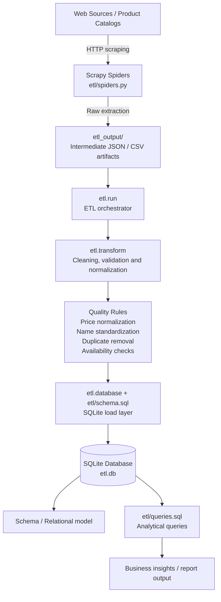

# Laboratorio ETL con Scrapy y SQLite

Este repositorio contiene ejercicios de Scrapy y un proceso ETL que extrae libros y laptops, limpia los datos y los carga en una base de datos SQLite relacional.

El proceso nuevo se encuentra en el paquete `etl/` y conserva el ejercicio anterior de citas.

## Portfolio & Author

- Portfolio: https://oskar-ortiz.vercel.app
- GitHub: https://github.com/oskar-ortiz
- This project exemplifies a practical data engineering pipeline built around extraction, transformation, governance, and analytical reporting in a local environment.

## Enterprise Architecture Overview



### Design Principles
- Decouple sourcing, transformation, and reporting into clearly independent stages.
- Preserve intermediate extraction artifacts for reproducibility and reprocessing.
- Normalize data before persistence to ensure analytical consistency.
- Treat SQLite as a durable analytical layer for local reporting and validation.
- Keep the workflow clear and inspectable for academic and enterprise-style data engineering review.

## Requisitos

- Python 3.10 o superior
- pip
- Virtualenv (opcional pero recomendado)

## Instalación y Configuración

1. Clonar el repositorio:

```bash
git clone https://github.com/oskar-ortiz/Laboratorio_ETL_SCRAPY
cd tu_repositorio
```

2. Crear un entorno virtual:

```bash
python -m venv env
# Linux / Mac
source env/bin/activate
# Windows
env\Scripts\activate
```

3. Instalar Scrapy:

```bash
pip install scrapy
```

## Ejecución del ETL

Desde la raíz del proyecto, con el entorno virtual activo:

```powershell
& .\env\Scripts\python.exe -m etl.run
```

El comando realiza las siguientes etapas:

1. Extrae todos los libros y laptops disponibles mediante Scrapy.
2. Guarda la extracción intermedia en `etl_output/`.
3. Limpia precios, calificaciones, disponibilidad, nombres y duplicados.
4. Crea o actualiza `etl.db` con las tablas relacionales.
5. Ejecuta las ocho consultas solicitadas y muestra sus resultados.

Para cargar nuevamente los JSON sin hacer peticiones web:

```powershell
& .\env\Scripts\python.exe -m etl.run --skip-extract
```

## Architecture & Data Pipeline Topology


### Topology Notes
- The process begins with external web extraction through Scrapy, transforming raw HTML content into structured records.
- The intermediate files stored in `etl_output/` allow reprocessing without repeating the network extraction step.
- The transformation stage is responsible for standardization, validation and enrichment, ensuring clean records before database load.
- SQLite acts as the final analytical storage layer, with a relational schema defined in `etl/schema.sql`.
- Query execution is separated from ingestion, allowing analytical use cases to remain reproducible and maintainable.

### Architecture Summary
- Extraction: `Scrapy -> etl_output/`
- Transformation: `etl.transform`
- Load: `etl.database + schema.sql -> SQLite`
- Analysis: `etl/queries.sql -> insights/report results`
- Design principle: clear separation between collection, refinement, and reporting

## Modelo de datos

El esquema está en [etl/schema.sql](etl/schema.sql) y contiene:

- `fuentes`: sitios de origen.
- `productos`: atributos comunes de libros y tecnología.
- `libros`: disponibilidad, stock, descripción y categoría.
- `tecnologia`: descripción específica de laptops.
- `categorias`: categorías normalizadas de libros.

Las consultas del laboratorio están en [etl/queries.sql](etl/queries.sql). La base puede abrirse directamente con DB Browser for SQLite.

## Documento de entrega local

El documento Markdown y el PDF de entrega se conservan únicamente en la carpeta local y no se publican en el repositorio. Para regenerar el PDF después de actualizar los resultados:

```powershell
& .\env\Scripts\python.exe -m etl.generate_pdf
```

## Estructura del Proyecto

```
etl/
├── database.py
├── queries.sql
├── run.py
├── schema.sql
├── spiders.py
└── transform.py
```

## Uso del Spider de citas

1. Desde `quotes_scraper/`, ejecutar el spider:

```powershell
& ..\env\Scripts\python.exe -m scrapy crawl quotes
```

2. Exportar resultados a CSV:

```bash
scrapy crawl quotes -o quotes.csv
```

3. Exportar resultados a JSON:

```bash
scrapy crawl quotes -o quotes.json
```

## Notas

- Asegúrate de que la URL objetivo sea accesible y que el spider esté correctamente configurado.
- Puedes modificar `settings.py` para ajustar configuraciones como `USER_AGENT`, `ROBOTSTXT_OBEY` o `DOWNLOAD_DELAY`.
- El ETL usa SQL directo y `sqlite3`, sin ORM.
- Para instalar las dependencias documentadas: `& .\env\Scripts\python.exe -m pip install -r requirements.txt`.
- Los precios se almacenan como números, pero no se convierten monedas porque el laboratorio no define una tasa de cambio.
